<div align="center">

# Sistema Integral de Gestión de Clientes, Servicios y Reservas

**Software FJ** · Aplicación de escritorio en Python, orientada a objetos, sin base de datos y con
manejo avanzado de excepciones


Curso **Programación (213023)** · Grupo **213023_638** · UNAD<br>
Fase 4: Componente práctico — Prácticas simuladas

</div>

---

## Contenido

1. [Qué hace](#qué-hace)
2. [Cómo ejecutarlo](#cómo-ejecutarlo)
3. [Cómo se usa](#cómo-se-usa)
4. [Cómo funciona por dentro](#cómo-funciona-por-dentro)
5. [Mapas de decisión](#mapas-de-decisión)
6. [Manejo de excepciones](#manejo-de-excepciones)
7. [Registro de eventos (logs)](#registro-de-eventos-logs)
8. [Simulación de operaciones](#simulación-de-operaciones)
9. [Estructura del repositorio](#estructura-del-repositorio)
10. [Equipo y trabajo colaborativo](#equipo-y-trabajo-colaborativo)
11. [Licencia](#licencia)

> [!TIP]
> Los diagramas de este README se pueden ampliar: pase el mouse sobre cualquiera de ellos y
> GitHub muestra botones para acercar, alejar, desplazar y abrirlo en pantalla completa.

---

## Qué hace

Software FJ ofrece tres tipos de servicio: **reserva de salas**, **alquiler de equipos** y
**asesorías especializadas**. El programa permite:

| Función | Descripción |
|---|---|
| Registrar clientes | Valida documento, nombre, correo y teléfono; guarda los datos personales como atributos privados y muestra el documento protegido (`******6789`) |
| Crear servicios | Cada tipo de servicio tiene sus propios datos, reglas y fórmula de costo |
| Gestionar reservas | Crea reservas con impuesto y descuento, y las confirma, cancela o procesa según su estado |
| Simular operaciones | Ejecuta 23 operaciones válidas e inválidas de una vez y demuestra que el sistema nunca se detiene |
| Registrar eventos | Escribe cada evento y cada error en `registro_eventos.log`, incluida la causa de los errores encadenados |

Toda la información vive en **objetos y listas en memoria**: no hay base de datos. El único archivo
que escribe el programa es el registro de eventos.

**Conceptos de programación orientada a objetos aplicados:**

| Concepto | Dónde se ve |
|---|---|
| Abstracción | Clases abstractas `Entidad` y `Servicio` con métodos `@abstractmethod` |
| Herencia | `Cliente`, `Servicio` y `Reserva` heredan de `Entidad`; tres servicios heredan de `Servicio` |
| Polimorfismo | Cada servicio sobrescribe `crear`, `validar_parametros`, `calcular_costo_base`, `describir` y `ayuda` |
| Encapsulación | Atributos privados (`__documento`, `__estado`…), propiedades que validan y listas internas protegidas |
| Sobrecarga | `calcular_costo` con tres variantes declaradas con `@overload` |
| Excepciones | 7 excepciones propias, `try/except`, `else`, `finally` y encadenamiento con `raise ... from` |

---

## Cómo ejecutarlo

**Requisitos:** Python 3.10 o superior con `tkinter` (viene incluido en el instalador oficial de
Windows). No necesita bases de datos ni paquetes adicionales.

| Opción | Pasos |
|---|---|
| Visual Studio Code | Abra `Integral_de_Gestión_de_C_S_R.py` y pulse ▶ (*Run Python File*) |
| Terminal | `python Integral_de_Gestión_de_C_S_R.py` |

Al iniciar se abre una ventana con cinco pestañas: **Clientes**, **Servicios**, **Reservas**,
**Simulación** y **Registro de eventos**.

---

## Cómo se usa

| Pestaña | Qué se hace | Botones |
|---|---|---|
| **Clientes** | Escribir documento, nombre completo, correo y teléfono | **Registrar cliente** |
| **Servicios** | Elegir el tipo de servicio; las etiquetas y la ayuda cambian según el tipo | **Crear servicio** · **Cambiar disponibilidad del seleccionado** |
| **Reservas** | Elegir cliente y servicio, escribir la duración, el IVA (19 % por defecto) y el descuento | **Crear reserva** · **Confirmar** · **Cancelar** · **Procesar** |
| **Simulación** | Ejecutar las 23 operaciones de demostración (una vez por sesión) | **Ejecutar simulación** |
| **Registro de eventos** | Ver el contenido de `registro_eventos.log` | **Actualizar** |

Cada operación exitosa se confirma con un cuadro de diálogo de información; cada error se muestra
con un cuadro de diálogo de error cuyo título es el tipo de excepción, y la ventana sigue abierta.

---

## Cómo funciona por dentro

### Flujo general de la aplicación

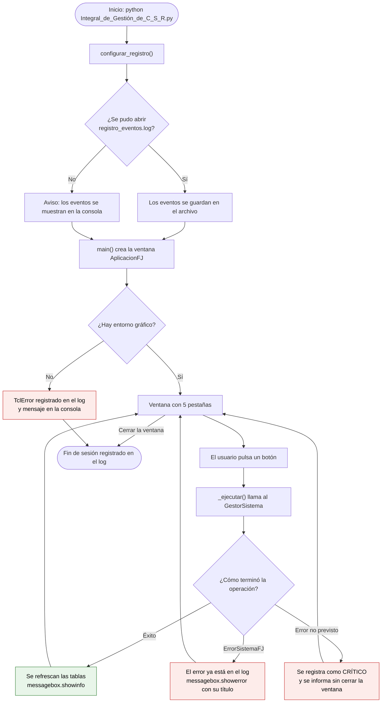

### Arquitectura en cinco secciones

El programa es un solo archivo dividido en cinco secciones. La lógica del negocio (secciones 1 a
4) no depende de la interfaz (sección 5), por eso sus clases se pueden usar sin abrir ninguna
ventana.

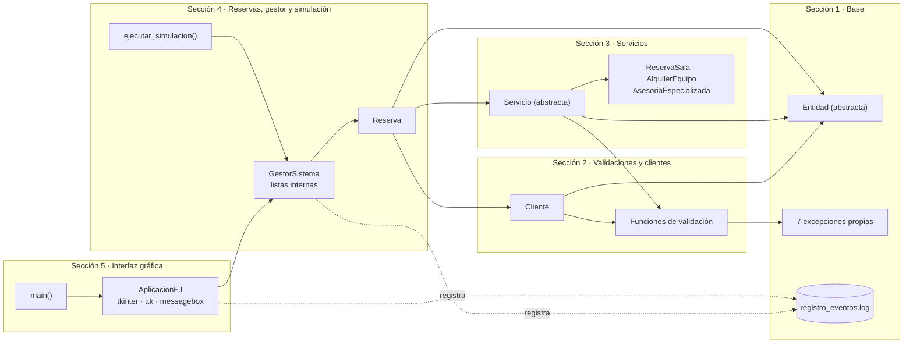

| Sección | Contenido | Aporte (según el encabezado del código) |
|---|---|---|
| 1 | Configuración, registro de eventos, excepciones personalizadas y clase abstracta `Entidad` | Jhon Jaiver Supelano Rojas |
| 2 | Funciones de validación y clase `Cliente` | Johan Ricardo Reina Florindo |
| 3 | Clase abstracta `Servicio` y servicios especializados | Mauro Daniel Rodríguez Pinzón |
| 4 | Clase `Reserva`, `GestorSistema` y simulación de operaciones | Nicolas Farid Salinas Carrillo |
| 5 | Interfaz gráfica (tkinter, ttk y messagebox) y punto de entrada | Líder del grupo de trabajo |

### Diagrama de clases

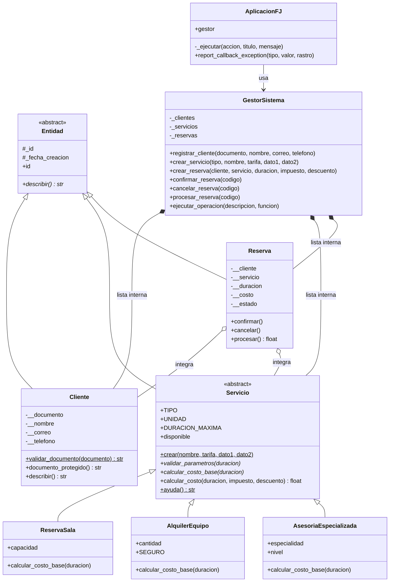

---

## Mapas de decisión

### Registro de un cliente

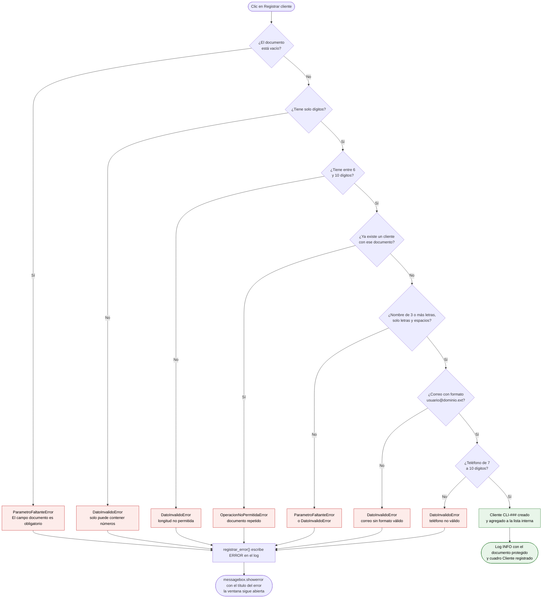

### Creación de un servicio

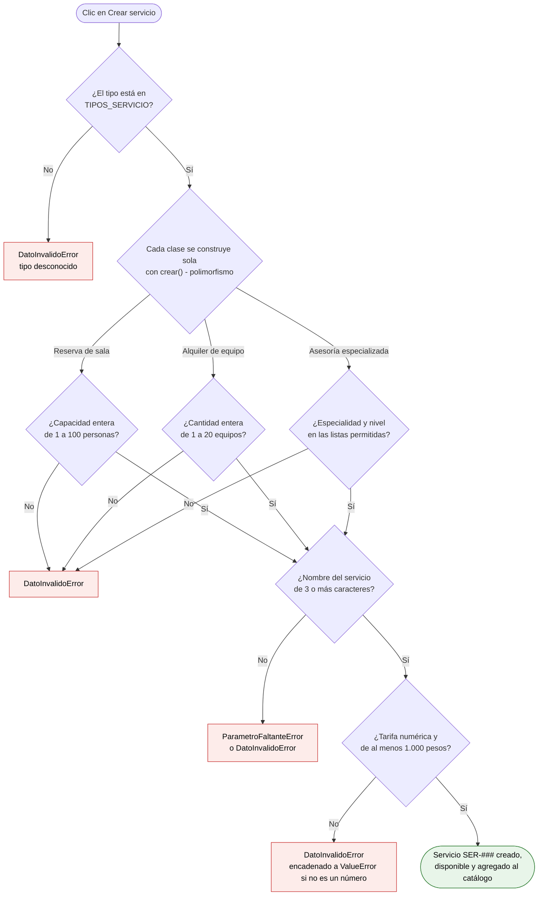

| Tipo de servicio | Dato propio | Duración por reserva | Fórmula del costo base |
|---|---|---|---|
| Reserva de sala | Capacidad: 1 a 100 personas | 1 a 8 horas (admite fracciones) | tarifa × horas |
| Alquiler de equipo | Cantidad: 1 a 20 equipos | 1 a 30 días completos | tarifa × días × equipos + 5 % de seguro |
| Asesoría especializada | Especialidad (software, redes, bases de datos, seguridad) y nivel | 1 a 6 horas | tarifa × horas × factor del nivel (básico 1,0 · avanzado 1,25 · experto 1,5) |

### Creación de una reserva

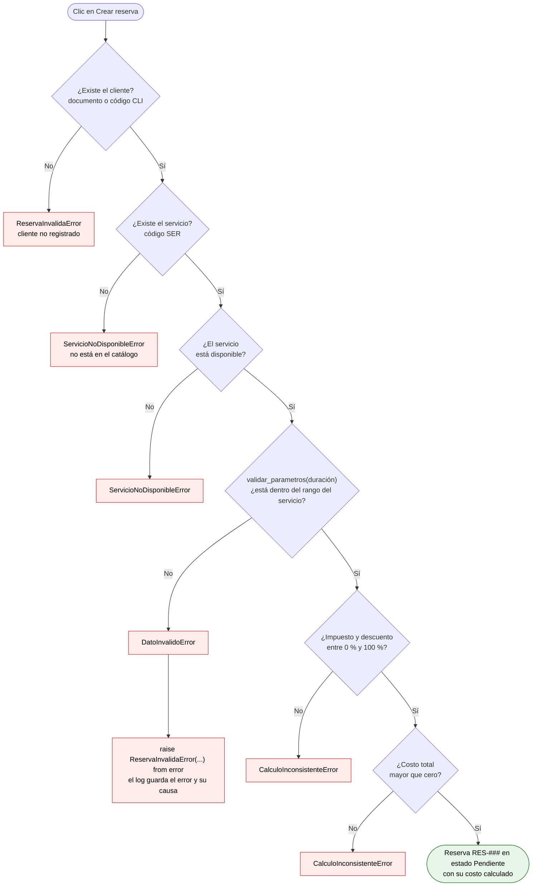

### Cálculo del costo: sobrecarga y polimorfismo

`calcular_costo` es un método sobrecargado: se declara con tres variantes (`@overload`) y una sola
implementación con parámetros opcionales. La parte que cambia según el servicio la resuelve el
polimorfismo.

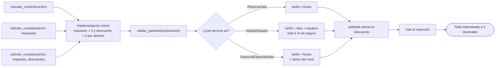

| Ejemplo: sala de 50.000 pesos por hora, 3 horas | Variante | Resultado |
|---|---|---|
| `calcular_costo(3)` | Solo el costo base | $ 150.000,00 |
| `calcular_costo(3, 19)` | Con IVA del 19 % | $ 178.500,00 |
| `calcular_costo(3, 19, 10)` | Con 10 % de descuento y luego el IVA | $ 160.650,00 |

### Ciclo de vida de una reserva

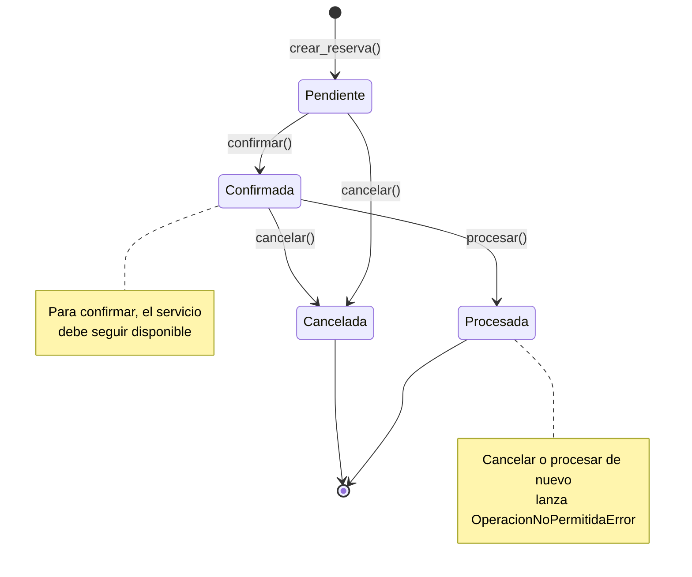

### Recorrido de una operación

Así viaja una reserva desde el botón hasta el archivo de logs, con el caso exitoso y el caso con
error encadenado:

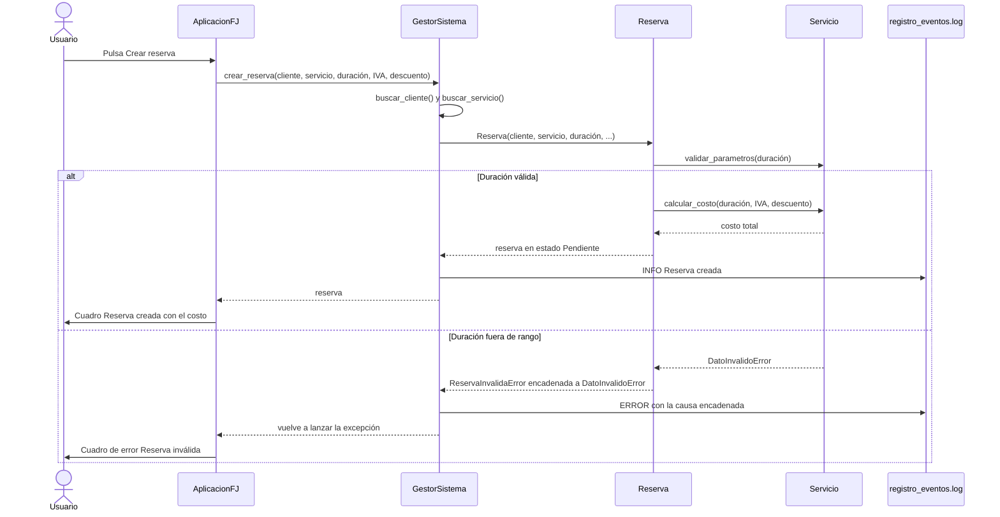

### Flujo de trabajo del equipo en GitHub

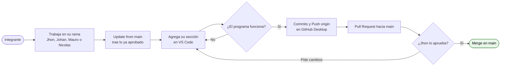

---

## Manejo de excepciones

### Jerarquía de excepciones propias

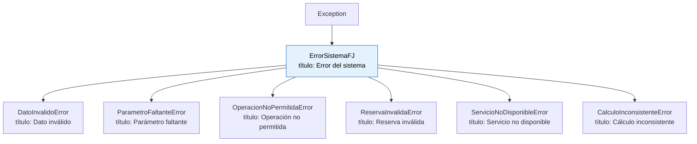

| Excepción | Cuándo se lanza | Ejemplo |
|---|---|---|
| `DatoInvalidoError` | Un dato tiene un formato o un valor no permitido | Correo sin @, tarifa negativa |
| `ParametroFaltanteError` | Falta un dato obligatorio | Nombre vacío, ninguna reserva seleccionada |
| `OperacionNoPermitidaError` | La acción no es válida en el estado actual | Documento repetido, cancelar una reserva procesada |
| `ReservaInvalidaError` | El intento de reserva no cumple las reglas | Cliente inexistente, duración fuera de rango |
| `ServicioNoDisponibleError` | El servicio no existe o está deshabilitado | Reservar un equipo marcado como no disponible |
| `CalculoInconsistenteError` | El cálculo recibe o produce valores sin sentido | Descuento del 150 % |

### Bloques usados y dónde

| Bloque | Dónde se usa | Para qué |
|---|---|---|
| `try/except` | Todos los métodos del gestor y la interfaz | Capturar el error, registrarlo y relanzarlo o mostrarlo |
| `try/except/else` | `configurar_registro`, `registrar_cliente`, `crear_servicio`, `crear_reserva`, `_ejecutar` | Guardar o informar solo cuando no hubo error |
| `try/finally` | `leer_registro` y `ejecutar_operacion` | Cerrar el archivo y registrar el fin de cada operación, falle o no |
| `try/except/else/finally` | `_cambiar_estado` y `main` | Dejar constancia del intento aunque la acción falle |
| `raise ... from` | `convertir_numero` y `Reserva` | Encadenar la excepción original como causa |

### Cómo una operación nunca detiene el sistema

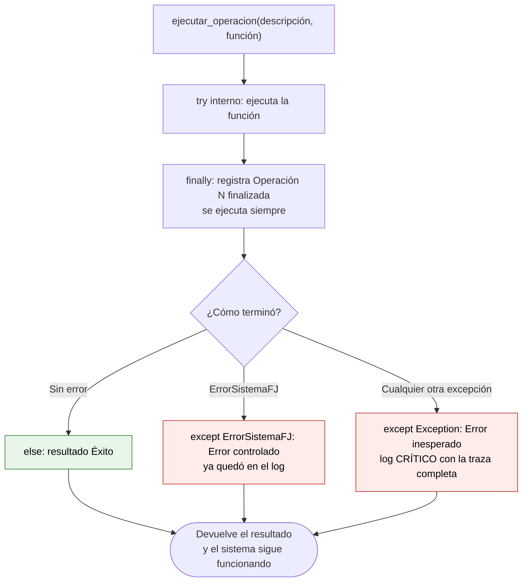

En la interfaz hay dos redes de seguridad más: `_ejecutar()` captura cualquier error de un botón,
y `report_callback_exception()` sobrescribe el método de tkinter para que un error en un evento
no cierre la aplicación.

---

## Registro de eventos (logs)

El archivo `registro_eventos.log` se crea en la carpeta del programa al ejecutarlo. Cada línea tiene
la fecha, el nivel y el mensaje. Los documentos de los clientes aparecen protegidos.

| Nivel | Uso |
|---|---|
| `INFO` | Eventos normales: inicio, registros, creaciones, cambios de estado y fin de cada operación |
| `ERROR` | Errores controlados, con su tipo y, si existe, la excepción que los originó |
| `CRÍTICO` | Errores no previstos, con la traza completa |
| `AVISO` | El archivo de logs no se pudo abrir y los eventos se muestran en la consola |

Ejemplo real de una sesión:

```text
2026-10-19 15:40:23 | INFO    | Cliente registrado: CLI-001 - Valentina Ruiz Castro | doc. ******6789 | valentina.ruiz@correo.com | tel. 3014567890
2026-10-19 15:40:25 | ERROR   | Registrar cliente -> DatoInvalidoError: El correo 'laura.rios.correo.com' no tiene un formato válido (ejemplo: usuario@dominio.com).
2026-10-19 15:40:33 | INFO    | Reserva creada: RES-001 - Valentina Ruiz Castro | Sala de capacitación | 3 horas | $ 160.650,00 | Pendiente
2026-10-19 15:40:35 | ERROR   | Crear reserva -> ReservaInvalidaError: No se pudo crear la reserva de 'Sala de capacitación': Una sala se reserva entre 1 y 8 horas; se pidieron 12. | Causa: DatoInvalidoError: Una sala se reserva entre 1 y 8 horas; se pidieron 12.
2026-10-19 15:40:38 | INFO    | Fin del intento de procesar la reserva RES-001.
2026-10-19 15:40:41 | CRÍTICO | Operación 23 (Operación no soportada: eliminar un cliente) -> error inesperado AttributeError: 'GestorSistema' object has no attribute 'eliminar_cliente'
```

> [!NOTE]
> El archivo de logs se genera cada vez que se ejecuta el programa; no hace falta subirlo al
> repositorio.

---

## Simulación de operaciones

La pestaña **Simulación** ejecuta 23 operaciones completas sobre los mismos datos de la
aplicación. Cada operación pasa por `ejecutar_operacion()`, así que ningún error detiene la
secuencia.

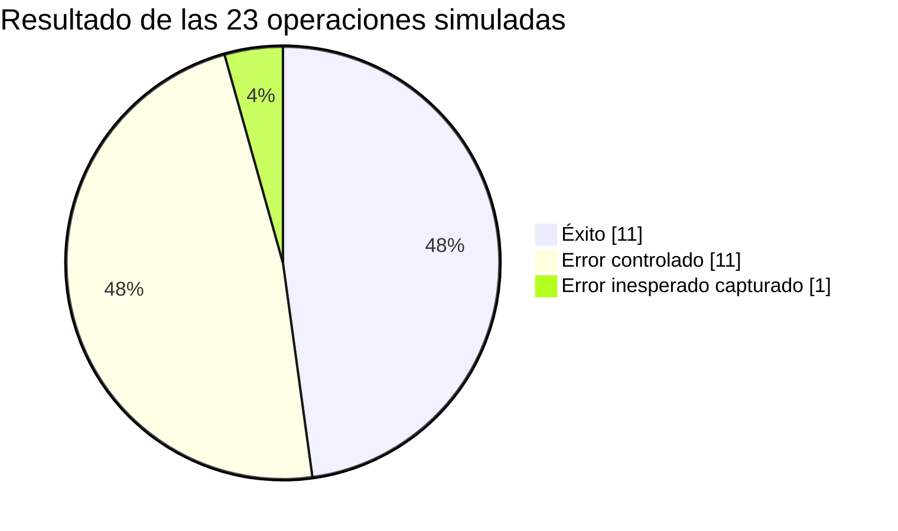

<details>
<summary><b>Ver las 23 operaciones y su resultado esperado</b></summary>

| N.º | Operación | Resultado |
|---|---|---|
| 1 | Registrar cliente válido: Ana María Gómez | Éxito |
| 2 | Registrar cliente válido: Carlos Pérez | Éxito |
| 3 | Registrar cliente con correo inválido | `DatoInvalidoError` |
| 4 | Registrar cliente sin nombre | `ParametroFaltanteError` |
| 5 | Registrar cliente con documento repetido | `OperacionNoPermitidaError` |
| 6 | Crear servicio: Sala de juntas | Éxito |
| 7 | Crear servicio: Portátiles | Éxito |
| 8 | Crear servicio: Asesoría en software | Éxito |
| 9 | Crear servicio con tarifa negativa | `DatoInvalidoError` |
| 10 | Crear asesoría con especialidad no ofrecida | `DatoInvalidoError` |
| 11 | Reservar la sala 3 horas con IVA del 19 % | Éxito: $ 178.500,00 |
| 12 | Confirmar la reserva de la sala | Éxito |
| 13 | Procesar (facturar) la reserva de la sala | Éxito |
| 14 | Reservar asesoría 2 horas con IVA y 10 % de descuento | Éxito: $ 257.040,00 |
| 15 | Cancelar la reserva de asesoría | Éxito |
| 16 | Cancelar otra vez la misma reserva | `OperacionNoPermitidaError` |
| 17 | Procesar una reserva cancelada | `OperacionNoPermitidaError` |
| 18 | Reservar la sala por 12 horas (máximo 8) | `ReservaInvalidaError` encadenada a `DatoInvalidoError` |
| 19 | Reservar con un cliente no registrado | `ReservaInvalidaError` |
| 20 | Marcar los portátiles como no disponibles | Éxito |
| 21 | Reservar portátiles no disponibles | `ServicioNoDisponibleError` |
| 22 | Reservar con un descuento del 150 % | `CalculoInconsistenteError` |
| 23 | Operación no soportada: eliminar un cliente | Error inesperado (`AttributeError`) capturado y registrado como CRÍTICO |

</details>

---

## Estructura del repositorio

```text
sistema-integral-CSR/
├── Integral_de_Gestión_de_C_S_R.py   # Programa completo en 5 secciones
├── LICENSE                           # Licencia MIT
└── README.md                         # Este documento
```

---

## Equipo y trabajo colaborativo

| Integrante | Rama |
|---|---|
| Jhon Jaiver Supelano Rojas (líder del grupo) | `Jhon` |
| Johan Ricardo Reina Florindo | `Johan` |
| Mauro Daniel Rodríguez Pinzón | `Mauro` |
| Nicolas Farid Salinas Carrillo | `Nicolas` |

Cada integrante trabaja en su propia rama con **GitHub Desktop** y **Visual Studio Code**, y sus
cambios llegan a `main` por medio de un Pull Request que revisa y aprueba el líder del grupo.

**Tutor:** Edduar Yakseir Perez Perez · **Universidad Nacional Abierta y a Distancia (UNAD)** ·
Escuela de Ciencias Básicas, Tecnología e Ingeniería

---

## Licencia

Este proyecto se distribuye bajo la licencia **MIT**. Consulte el archivo [LICENSE](LICENSE).
